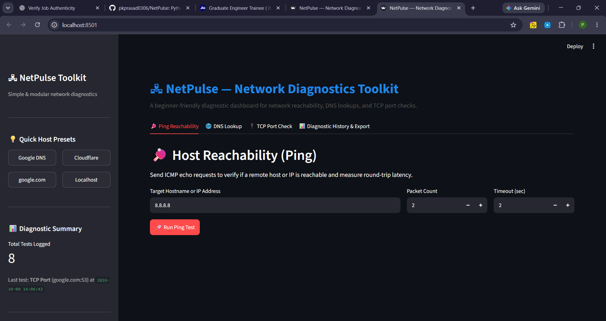

# NetPulse — Network Diagnostics Toolkit

A beginner-friendly network diagnostics dashboard built with Python and Streamlit. NetPulse helps users perform basic connectivity checks, inspect DNS records, test TCP port connectivity, and review diagnostic history through a simple web interface.

## Live Demo

Try NetPulse online: [**Launch NetPulse**](https://netpulse-8dhnnt8kfxygjiyynhyqgd.streamlit.app/)

No local installation is required to explore the dashboard.

## Dashboard Preview



## Features

- **Ping Reachability:** Check whether a hostname or IP address is reachable and inspect round-trip latency.
- **DNS Lookup:** Query supported DNS records and view resolution results.
- **TCP Port Check:** Test connectivity to a specified TCP port on a target host.
- **Diagnostic History:** Store and review previous diagnostic results.
- **CSV Export:** Download diagnostic history for further analysis.
- **Input Validation:** Validate hostnames, IP addresses, and port values before running checks.
- **Automated Tests:** Unit tests cover the main diagnostic functions and history management.

## Technology Stack

- **Language:** Python
- **Web interface:** Streamlit
- **Networking:** Python socket programming and system ping utilities
- **DNS:** dnspython and socket-based resolution
- **Data handling:** Pandas and CSV
- **Testing:** pytest

## Project Structure

```text
NetPluse/
├── core/
│   ├── dns_lookup.py
│   ├── history_manager.py
│   ├── ping_checker.py
│   └── port_scanner.py
├── data/
│   └── .gitkeep
├── screenshots/
│   └── netpulse-dashboard.png
├── tests/
│   ├── test_dns_lookup.py
│   ├── test_history_manager.py
│   ├── test_ping_checker.py
│   └── test_port_scanner.py
├── app.py
├── requirements.txt
├── README.md
└── .gitignore
```

## Getting Started

### Prerequisites

- Python 3.10 or a compatible version
- Git
- An internet connection for testing external hosts and DNS queries

### 1. Clone the repository

```bash
git clone https://github.com/pkprasad0306/NetPulse.git
cd NetPulse
```

### 2. Create and activate a virtual environment

**Windows PowerShell:**

```powershell
python -m venv .venv
.\.venv\Scripts\Activate.ps1
```

If PowerShell blocks activation, you can run the commands below using `.venv\Scripts\python.exe` directly instead.

### 3. Install dependencies

```powershell
python -m pip install -r requirements.txt
```

### 4. Run the application

```powershell
python -m streamlit run app.py
```

Open the local URL shown in the terminal.

## Run Tests

Install pytest if it is not already included in your environment:

```powershell
python -m pip install pytest
```

Run the test suite:

```powershell
python -m pytest tests/ -v
```

The project has **24 passing unit tests** in the latest recorded test run.

## Scope and Limitations

NetPulse is a learning and troubleshooting tool for basic host reachability, DNS resolution, and TCP connectivity. It is not a telecom core-network monitoring platform and does not analyze cellular signalling, mobile subscriber sessions, or production network KPIs.

Results depend on the local environment, firewall rules, network access, and the availability of the target host.

## Future Improvements

- Add visual summaries of diagnostic history.
- Improve error reporting and troubleshooting guidance.
- Deploy a hosted demonstration.
- Expand test coverage for additional network edge cases.

## Author

**Prasad Kasurde**

GitHub: [pkprasad0306](https://github.com/pkprasad0306)

---

This project was developed for practical learning in Python, networking fundamentals, and automated testing.